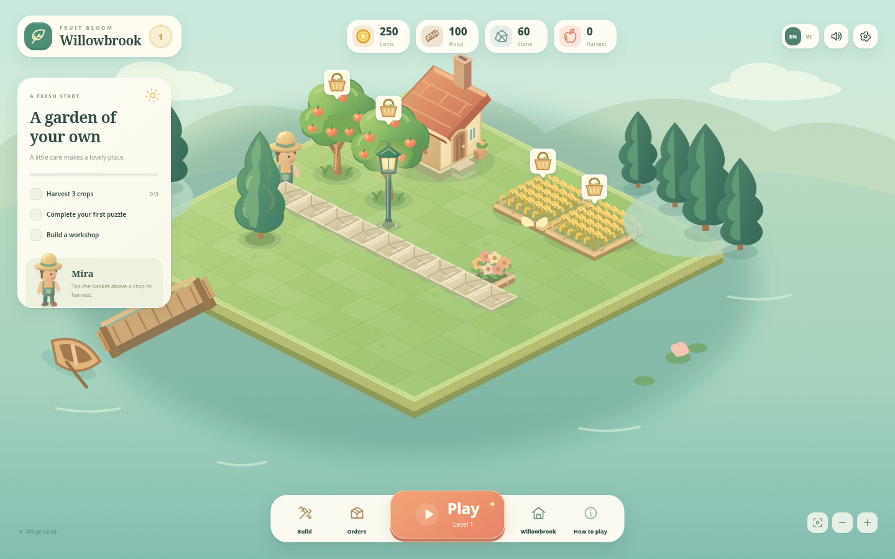
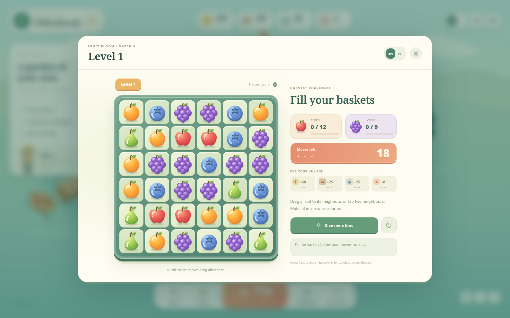
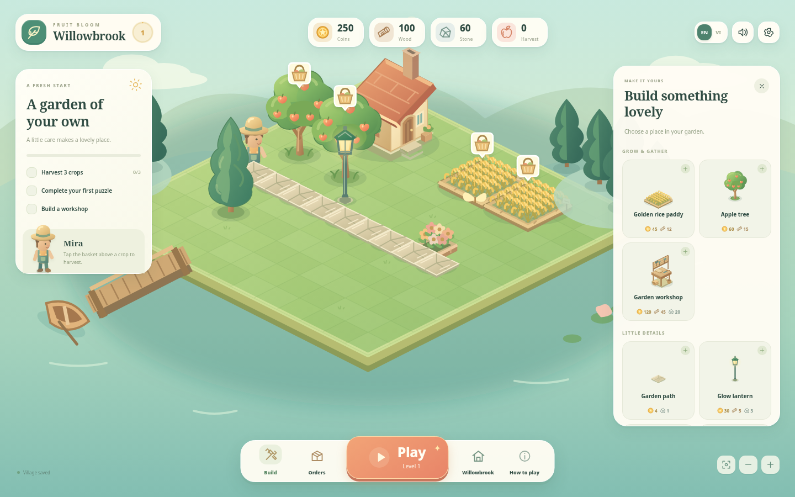
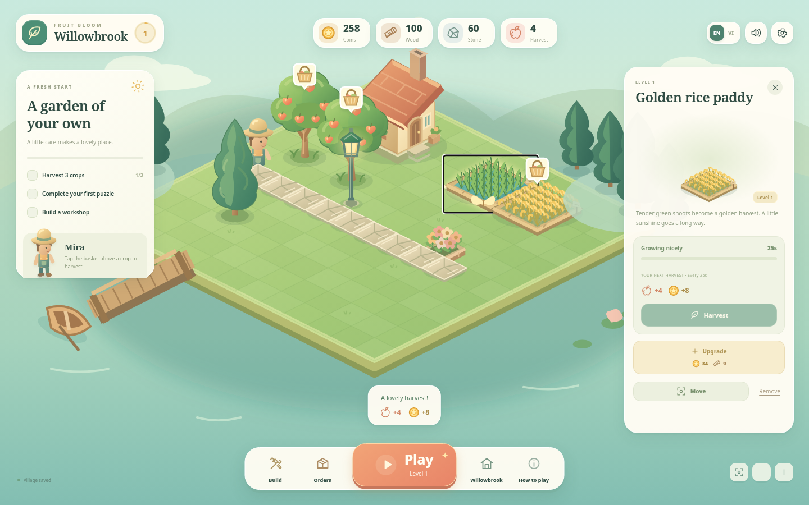

# Fruit Bloom

A playable garden village with a connected **harvest → match-3 → build** loop.
Start in Willowbrook, gather your first crops, win materials from fruit puzzles,
and use them to grow and decorate the same village. English is the default;
Vietnamese can be selected at any time.

## Play on PC

1. Download [Fruit-Bloom-PC.zip](https://github.com/DucPhan1509/Game/raw/refs/heads/main/downloads/Fruit-Bloom-PC.zip).
2. Extract the ZIP, then double-click **Fruit-Bloom-PC.html**. No installation,
   server, or internet connection is required.
3. Use **VI / EN** to change language. Progress saves in this browser when storage
   is available; keep using the same file location and browser for your saved village.

For source code, download the [repository ZIP](https://github.com/DucPhan1509/Game/archive/refs/heads/main.zip),
extract it fully and open `index.html`. Previously downloaded copies do not update
automatically. `downloads/` contains the current playable release; `dist/` is generated locally.



## Your first few minutes

- **Harvest:** click a basket above a ripe rice paddy or apple tree. Crops grow
  again automatically. Rice and fruit both contribute to the **Harvest** resource.
- **Play:** open the next match-3 level directly from the main dock. Swap two
  neighboring fruits to make a row or column of three or more. Complete both
  collection goals before your moves run out to receive village materials.
- **Build:** choose a crop, workshop or decoration, then click a clear tile on
  the main map. The displayed cost is deducted when placement succeeds.
- **Orders:** deliver the requested harvest and materials for coins and supplies.
- **Improve:** select an item in the village to see production, upgrade it,
  move it for free, or remove it for half its base building cost. The cottage
  can be moved and upgraded but cannot be removed.

The opening tasks guide you through three harvests, your first puzzle win and
building a workshop. Later tasks lead to orders, more puzzles and a cottage upgrade.

Drag the landscape to pan. Use the wheel or camera buttons to zoom. Press Escape
to cancel placement or close the open panel. Sound effects and reduced motion
can be changed in Settings. Landscape phones are supported; portrait screens
show a rotation prompt.

## Match-3 and progression

The first level has a 6×6 board, 18 moves, and goals of 12 apples and 9 grapes.
Drag a fruit toward its neighbor, or click the two tiles in sequence. Invalid
swaps return without spending a move. Gravity, refill and chain matches follow
each successful swap, and the board reshuffles if it has no legal move.

Use the hint button when needed. Keyboard controls use arrows to navigate and
Space or Enter to select the two neighboring tiles. Winning grants the shown
coins, wood, stone and harvest once, then opens the next level. Losing allows a
retry. Eight stage configurations vary the goals and move budgets; later levels
reuse those configurations with different seeds.



## A village you can change

The main scene is a 12×12 isometric grid with separate shaded SVG objects:
ripe and growing rice, apple trees, a cottage, workshop, paths, lanterns,
flowers, cypresses and a fountain. Placement checks the entire footprint and
prevents overlap or building beyond the village boundary.

At level 1, rice grows in 25 seconds, apple trees in 40 seconds and workshops
produce building materials in 45 seconds. Upgrades shorten the cycle and
increase its yield. Timers continue while the game is closed, up to the next
ready collection; resources are granted when you collect them.

Crops, water, leaves and the gardener have separate animations. These are scene
animations; there is no resident assignment or autonomous worker simulation in
this version. All buildings, resources, upgrades, orders and completed levels
save locally in the browser. If storage is unavailable, play continues for the
current visit. There is no account, cloud sync, gacha or real-money shop.





This is a coherent playable slice of the game. Balancing, special puzzle pieces,
obstacles, a larger campaign and more character activities remain future work.
The earlier [design discussion](docs/design-direction-v2.vi.md) and
[art comparison](docs/modular-art-study.png) record the exploration before this
revision; they are not screenshots of the current game.

## Chơi thử trên PC

Tải [Fruit-Bloom-PC.zip](https://github.com/DucPhan1509/Game/raw/refs/heads/main/downloads/Fruit-Bloom-PC.zip),
giải nén rồi mở **Fruit-Bloom-PC.html**. Không cần cài đặt, mở máy chủ hay kết nối
mạng. Hình vẽ, mã game và font tiếng Việt đã được nhúng vào một file.
Dùng cùng trình duyệt và giữ nguyên vị trí file để tiếp tục làng đã lưu.
Bản đã tải về không tự cập nhật; tải ZIP mới khi có bản nâng cấp.

Bản này nối các phần thành một vòng chơi trên cùng ngôi làng:

1. Bấm giỏ trên ruộng chín hoặc cây táo để **thu hoạch**. Lúa và trái cây đều
   tạo tài nguyên **Nông sản**; cây trồng tự lớn lại sau khi thu.
2. Bấm **Chơi** để vào màn ghép 3. Kéo hoặc bấm hai trái liền kề để đổi chỗ.
   Thu đủ mục tiêu trong số lượt cho phép để nhận vật liệu và mở màn tiếp theo.
3. Bấm **Xây dựng**, chọn ruộng, cây, xưởng hoặc đồ trang trí rồi đặt vào ô trống
   ngay trên bản đồ. Chi phí chỉ bị trừ khi đặt thành công.
4. Mở **Đơn hàng** để đổi nông sản lấy xu và vật liệu. Chọn vật đã đặt để nâng
   cấp, di chuyển hoặc dỡ bỏ; dỡ bỏ hoàn lại nửa chi phí xây ban đầu.

Lúa xanh chuyển sang lúa vàng, cây táo có trạng thái đang lớn và có quả; xưởng
làm ra gỗ và đá. Có âm thanh, chuyển động cảnh, tiến trình nhiệm vụ và lưu game
trên trình duyệt. Mặc định là tiếng Anh; dùng **VI / EN** để đổi ngôn ngữ. Font
hỗ trợ tiếng Việt đầy đủ được đóng gói cùng game, không cần tải từ mạng.

Thời gian cây trồng tiếp tục đến lần thu hoạch kế tiếp khi bạn rời game, nhưng
phải bấm thu hoạch để nhận tài nguyên. Cư dân hiện có chuyển động trong cảnh;
hệ thống tự đi làm việc, đồng bộ tài khoản và nền kinh tế thương mại chưa nằm
trong bản này.

## GitHub Pages

The website address is **https://ducphan1509.github.io/Game/**. Each successful
run of **Publish Fruit Bloom to GitHub Pages** publishes the version on `main`.

Keep **Settings → Pages → Build and deployment → Source: GitHub Actions**.
Pushing to `main` runs the deployment automatically. To retry a deployment, open
**Actions → Publish Fruit Bloom to GitHub Pages → Run workflow** and select `main`.
Both `build` and `deploy` must succeed before the website receives the update.

`python3 scripts/stage_site.py` stages the page, scripts, styles and local font files. Historical concept PNGs and development tools are excluded
from the published site.

## Development

Python 3 is the only required development runtime. Node/npm is optional for
command aliases and model tests. No package installation is needed to run the game.

```sh
python3 scripts/serve.py 4173
python3 scripts/build.py
```

The server listens on loopback for local development. The builder writes
`dist/Fruit-Bloom-PC.html` and `dist/Fruit-Bloom-PC.zip`. Rebuild after source
changes; running the server does not refresh the exported files. Equivalent
commands are `npm run dev` and `npm run build`.

Before a release, run `python3 scripts/build.py --release` to refresh the committed
`downloads/Fruit-Bloom-PC.zip` as well.

Active source modules:

- `src/app.js`, `src/styles.css`: unified village interface and navigation.
- `src/game-state.js`: inventory, production, construction, orders, levels and saves.
- `src/world.js`, `src/world.css`: map rendering, camera, placement and interaction.
- `src/world-art.js`: original modular SVG artwork and animation parts.
- `src/puzzle.js`, `src/puzzle.css`: match-3 model, effects, goals and reward callbacks.
- `src/ui-copy.js`, `src/i18n.js`: English and Vietnamese text.
- `src/typography.css`, `assets/fonts/`: bundled fonts and SIL Open Font License notices.
- `scripts/build.py`: portable HTML/ZIP export. The scene, characters and fruit are SVG source; the export includes the local fonts.

## Validation

Model tests use Node. Browser checks use Python Playwright and Chromium from the
development environment; the exported game does not depend on those tools.

```sh
node tests/game_state.cjs
node tests/puzzle_model.cjs
python3 tests/playthrough.py
python3 tests/playthrough.py --standalone dist/Fruit-Bloom-PC.html
python3 tests/typography.py
python3 tests/typography.py --standalone dist/Fruit-Bloom-PC.html
```

Checks cover connected gameplay, local saving, resource transactions, production
readiness, placement boundaries, reward idempotence, match-3 rules and actual
browser interaction. The offline check blocks external subresources. Typography
checks inspect the browser's actual font use for Vietnamese text.
