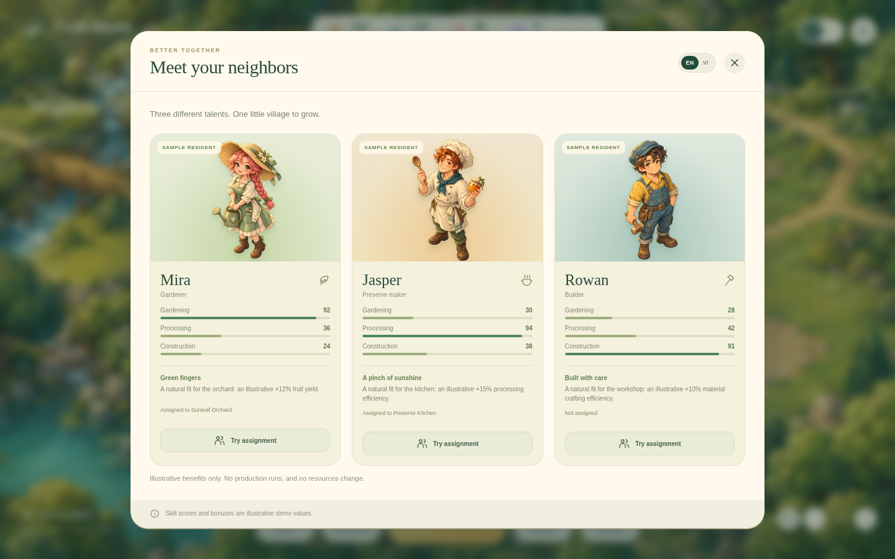

# Fruit Bloom

A small, illustrated garden village you can explore on a PC. This is an interactive **web prototype**, with English as the default language and a complete Vietnamese option.

## Preview the artwork




## Browser preview on GitHub Pages

The configured site address is **https://ducphanminh293-tech.github.io/Game/**.
It becomes available after Pages is enabled and the deployment workflow succeeds.

For this repository, select **Settings → Pages → Build and deployment → Source:
GitHub Actions**. Then run **Actions → Publish Fruit Bloom to GitHub Pages → Run
workflow** if the initial deployment has not completed. Later pushes to `main`
deploy automatically. No API keys or server are required for the game.

The workflow stages only `index.html`, `src/`, `assets/` and `.nojekyll` using
`python3 scripts/stage_site.py`. Source files, generated PC downloads and test
tools remain separate from the published site.

## Open the PC preview

1. Download `dist/Fruit-Bloom-PC.html` and open it in a current desktop browser, such as Chrome, Edge, Firefox, or Safari.
2. If you download `dist/Fruit-Bloom-PC.zip`, extract it first, then open `Fruit-Bloom-PC.html`.
3. No account, installation, Internet connection, or local server is required for the exported HTML.

Click buildings, residents, and the navigation buttons to explore. Drag the garden to pan, use the zoom controls to look closer, and close a window to return to the village. Use the language switch to change between English and Vietnamese; the selected language is remembered when browser storage is available.

The preview includes building information, three sample residents, demo assignments and their illustrated benefits, storage, recruitment presentation, and the next stage's objectives and rewards. Production, actual recruitment, fruit-shooting gameplay, generated stages, and reward claims are not implemented. All quantities and assignment bonuses are illustrative, not final balance rules. The preview does not charge tickets or real money.

Landscape phones are also supported; portrait screens show a rotate-device prompt. A desktop browser provides the intended PC review experience.

## Development

Python 3 is the only required development runtime. Node/npm is optional and provides convenient command aliases.

```sh
cd /workspace/Game
python3 scripts/serve.py 4173
```

The development server listens on the machine's loopback interface. This address is for local development and automated validation; the downloadable HTML is the portable user preview.

Build the portable preview after changing the source:

```sh
python3 scripts/build.py
```

Equivalent commands are `npm run dev` and `npm run build`. No package installation is required.

Source layout:

- `index.html`: page shell and script order.
- `src/styles.css`: layout, art presentation, responsive behavior, and reduced motion.
- `src/app.js`: interaction and demo state.
- `src/data.js`: sample resources, buildings, residents, and stage.
- `src/i18n.js`: English and Vietnamese interface copy.
- `src/icons.js`: interface icons.
- `assets/`: village and character artwork.
- `scripts/build.py`: embeds scripts, styles, and artwork in a self-contained HTML file and ZIP.

The builder writes `dist/Fruit-Bloom-PC.html` and `dist/Fruit-Bloom-PC.zip`. Rebuild before sharing; running the source server does not refresh exported artifacts.

## Mở bản xem trước trên PC

Tải `Fruit-Bloom-PC.html` về máy rồi mở bằng Chrome, Edge, Firefox hoặc Safari. Nếu tải bản ZIP, hãy giải nén trước. Bản HTML mở được trực tiếp, không cần cài đặt hay kết nối mạng.

Kéo khu vườn để di chuyển góc nhìn, dùng nút thu phóng và bấm vào công trình hoặc các nút điều hướng để khám phá. Giao diện mặc định là tiếng Anh; nút **VI / EN** cho phép đổi ngôn ngữ và ghi nhớ lựa chọn khi trình duyệt cho phép lưu dữ liệu.

Đây là bản giao diện có tương tác để duyệt thiết kế. Bạn có thể thử phân công cư dân và xem lợi ích minh họa. Gameplay bắn trái cây, sản xuất theo thời gian, quay gacha thật và nhận thưởng chưa được triển khai. Các số liệu đều là dữ liệu demo.

## Validation

The browser smoke suite uses Python Playwright and Chromium from the development
machine. They are testing tools only; the exported game has no runtime dependency
on them.

```sh
python3 tests/smoke.py
python3 tests/smoke.py --standalone dist/Fruit-Bloom-PC.html
```

The standalone check blocks subresource requests and confirms artwork is embedded.
The suite covers English defaults, language changes, demo assignment consistency,
persistence, modal navigation, camera controls, and desktop/mobile layouts.

## Design decisions still open

- Construction and upgrade costs, production rules, and expansion progression.
- Recruit rarities, odds, ticket cost, pity rules, duplicate handling, and progression.
- Puzzle balancing, cluster-drop rules, and validated random stage generation.

The prototype does not lock these decisions in. Sample values live in `src/data.js`.
