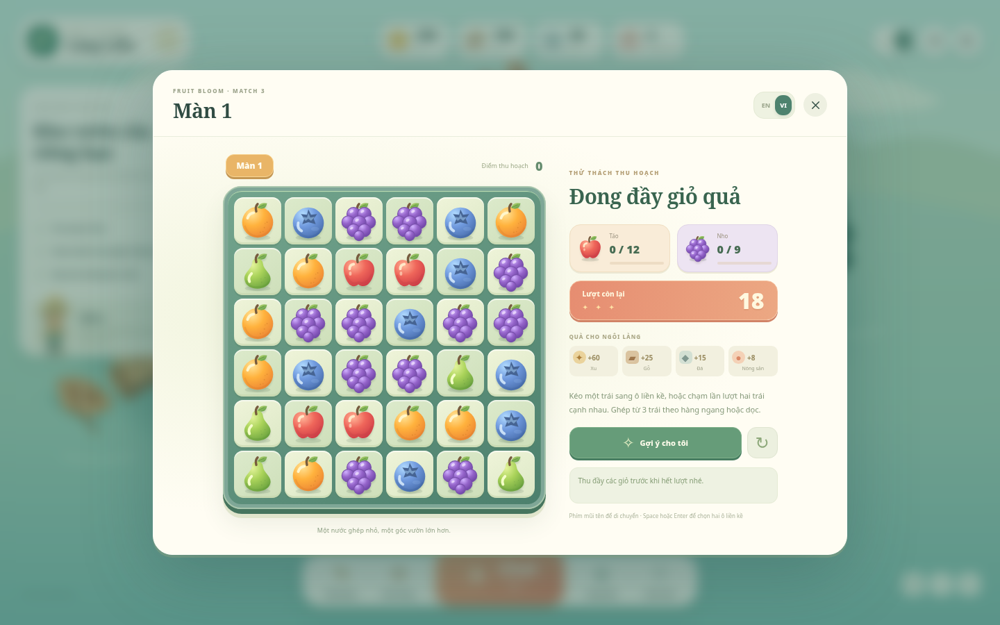
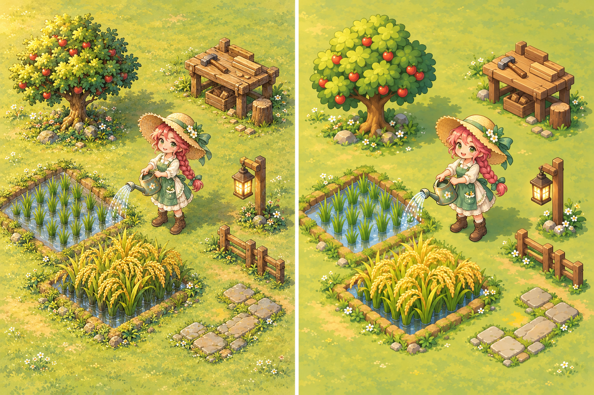
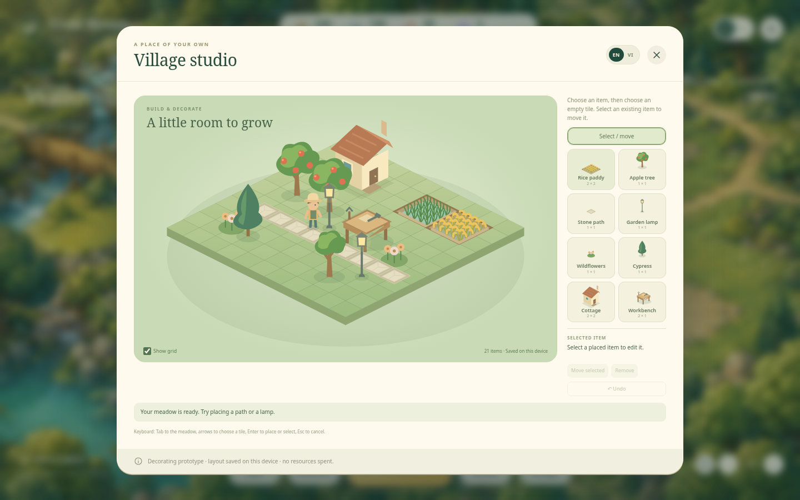

# Fruit Bloom: điều chỉnh hướng thiết kế

> Tài liệu lưu lại giai đoạn trước bản 0.4. Ngôi làng mới hiện đã nối thu hoạch,
> ghép 3, xây dựng và đơn hàng. Xem [README hiện tại](../README.md) để chơi bản mới.

Tài liệu này ghi lại đánh giá sau khi xem bản prototype và phản hồi của chủ dự án.
Font tiếng Việt đã được sửa trong mã nguồn. Chủ dự án đã chọn chuyển phần giải
đố sang đổi chỗ ghép 3. Màn chơi mới và xưởng thiết kế làng riêng đã có thể chơi
thử. Sản xuất, hành vi làm việc của cư dân và mỹ thuật hoàn chỉnh bên dưới vẫn
là hướng phát triển, chưa phải tính năng đã hoàn thành.

## 1. Font tiếng Việt

Các chuỗi tiếng Việt hiện đã ở Unicode NFC. Giao diện trước đây dùng Georgia và
Trebuchet MS có sẵn trên máy, nên không kiểm soát được khả năng hiển thị dấu và
font thay thế của Windows. Bản sửa đóng gói font hỗ trợ tiếng Việt cùng trò chơi,
áp dụng cho cả giao diện và chữ trên bảng chơi. Không dựa vào việc máy người chơi
đã cài font hoặc có kết nối mạng.

## 2. Chọn vòng giải đố

| Hướng | Thao tác chính | Điểm cần kiểm chứng |
| --- | --- | --- |
| Bắn trái cây ở bản trước | Ngắm, bắn, ghép cụm; gần bắn trứng khủng long | Cảm giác ngắm bắn, phản hồi va chạm, độ thú vị của bố cục |
| Đổi chỗ ghép 3 như Candy Crush | Đổi hai ô liền nhau để tạo hàng/cột từ ba ô | Độ dễ đọc của bàn, combo, mục tiêu màn và tốc độ giải quyết lượt |

Cả hai đều là những dòng giải đố thương mại lâu năm. Không có dữ liệu thị trường
mới được xác minh trong phiên làm việc này để xếp hạng số người chơi, doanh thu
hay chi phí thu hút người chơi. Sự thành công của Candy Crush không chứng minh một
game mới cùng thể loại sẽ thành công.

**Quyết định của chủ dự án: đổi sang kéo đổi chỗ, ghép 3.** Vào **Chơi → Chơi
ghép 3** để chơi bản kiểm chứng: bàn 6×6, 18 lượt, thu đủ 12 táo và 9 nho. Có
thể kéo hoặc bấm lần lượt hai ô cạnh nhau; ghép thành hàng/cột từ ba quả sẽ xóa
quả, rơi và bổ sung ô để tạo chuỗi ghép. Đổi không tạo bộ ghép sẽ trả về và không
mất lượt. Có gợi ý, thắng, thua và chơi lại; bảng tự xáo khi hết nước hợp lệ.

Đây là lựa chọn trải nghiệm cho dự án, không phải kết luận về lượng người chơi.
Số lượt, phần thưởng, combo và gacha vẫn cần thử nghiệm; màn demo không cộng tài
nguyên thật và không chốt nền kinh tế chính thức.

## 3. Đổi cấu trúc làng trước khi thêm công trình

Cảnh làng chính hiện tại vẫn dùng `garden.png` chứa sẵn đường, sông, đá và dáng đất. `orchard.png` gộp
cây, nhà kho, hàng rào và mặt đất. `renderWorld()` đặt các cụm tại tọa độ màn hình
cố định. Vì vậy cảnh đó phù hợp để duyệt hình ảnh, chưa phải nền tảng xây làng
tự do. Xưởng thiết kế mới ở phần 6 dùng dữ liệu ô và vật thể riêng để kiểm chứng
cấu trúc thay thế; chưa thay toàn bộ cảnh chính.

Hướng thay thế:

- **Đất:** các ô cỏ, đất canh tác, bờ nước; nền thoáng và ít chi tiết hơn vật thể.
- **Ruộng lúa:** thửa đất hoặc nước nông, hàng mạ riêng, bụi lúa lớn, bông lúa
  chín rủ xuống. Có hình khác nhau ở các giai đoạn, nhận ra là ruộng dù không có nhãn.
- **Cây ăn quả:** từng cây riêng, có trạng thái cây non, cây trưởng thành và có
  quả. Tán, quả, bóng hoặc sprite trạng thái tách được để rung và thu hoạch.
- **Xưởng:** nơi làm việc nhìn ra chức năng, như bàn chế biến, nồi và rổ trái;
  bàn mộc, gỗ và dụng cụ. Nhà chính vẫn là một công trình, không đại diện cho mọi
  hoạt động sản xuất.
- **Decor:** mỗi đoạn đường, đèn, hàng rào, cây cảnh là một vật thể có vị trí riêng.
- **Cư dân:** có vị trí và trạng thái hoạt động riêng, không dính vào ảnh công trình.

Xưởng mới dùng lưới isometric 2:1 gồm 11×11 ô. Đường/đèn/cây chiếm 1×1 ô,
ruộng và nhà nhỏ 2×2, bàn làm việc 2×1. Đây là thông số thử nghiệm. Nhà chính
lớn hơn và các kích thước khác có thể bổ sung sau khi kiểm chứng cách trang trí.
Mỗi vật thể lưu `id`, loại, tọa độ ô, diện tích chiếm ô và trạng thái. Renderer
sắp lớp theo điểm tiếp đất; dữ liệu ô dùng để kiểm tra chỗ đặt và có thể mở rộng
cho tìm đường sau này.
Khi đổi kích thước màn hình, thay camera và UI; giữ nguyên tọa độ của làng.

Xưởng đã có hình xem trước, báo vị trí hợp lệ/không hợp lệ, đặt/hủy, di chuyển,
dỡ bỏ, hoàn tác và lưu bố cục. Không cho đặt vật thể đè lên nhau hoặc ra ngoài
khu đất. Kiểm tra đường đi tới vị trí làm việc của cư dân vẫn thuộc bước sau.

## 4. Chuyển động và hành vi

PNG 2D vẫn dùng được cho game động. Vấn đề là cách tách tài nguyên và biểu diễn
trạng thái, không phải bắt buộc chuyển sang 3D.

- Nhân vật: đứng → đi tới điểm làm việc → tưới/chế biến/thu hoạch → trở về.
- Luống: mới trồng → lớn → chín → vừa thu hoạch; xem trước bằng nút điều khiển
  trạng thái trước khi làm hệ thống thời gian thật.
- Cây: lá đung đưa nhẹ, quả phản hồi khi thu hoạch; đèn có quầng sáng riêng.
- Xưởng: cánh quạt/khói/động tác dụng cụ riêng khi đang hoạt động.

Nhún hoặc trượt nguyên hình hiện tại chỉ là chuyển động trình diễn. Sprite có
vài khung đi bộ/làm việc sẽ thuyết phục hơn; cũng có thể dùng các bộ phận rời cho
những vật thể phù hợp. Chuyển động trang trí phải tôn trọng tùy chọn giảm chuyển động.

## 5. Đánh giá mỹ thuật

Điểm giữ lại: tông xanh và gỗ ấm, ánh sáng thống nhất, không khí khu vườn yên bình.
Điểm cần sửa: nền quá nhiều chi tiết, cư dân nhỏ và chìm, vật thể sản xuất khó đọc
ở kích thước điện thoại, cụm nhà/cây giống tiểu cảnh trưng bày hơn đồ chơi có thể
di chuyển.

Chưa có cơ sở khẳng định phong cách hiện tại hợp số đông. Hai hướng đáng so sánh:

1. Minh họa ấm áp hiện tại nhưng giảm chi tiết, tăng tương phản và tách vật thể.
2. Casual 2D có khối rõ, nhân vật khoảng ba đầu, cây/quả và công cụ có silhouette
   dễ đọc; giữ bảng màu dịu, tránh biến thành giao diện quá trẻ con.

**Ảnh nghiên cứu mỹ thuật do AI tạo, chưa phải ảnh chụp một bản đồ đã làm lại.**
Bên trái giữ nhiều chi tiết minh họa; bên phải giảm chi tiết và làm hình khối rõ
hơn. Các vật thể được minh họa rời về mặt bố cục, nhưng file này vẫn là một ảnh
tham khảo. Xưởng mới dùng mô hình ô đất và những hình vector đơn giản được vẽ
riêng để thử thao tác; chưa dùng bộ mỹ thuật trong ảnh này. Để đạt chất lượng
như mẫu cần tạo từng tài nguyên riêng. Không dùng cả ảnh này thay cho nền bản đồ.

Đề xuất ưu tiên hướng bên phải, tiếp tục làm nền thoáng hơn và giữ kích thước
nhân vật/cây trồng đủ lớn khi thu về màn hình điện thoại. Đây là nhận định về độ
dễ đọc và khả năng sản xuất tài nguyên, không phải kết quả khảo sát thị trường.

Đánh giá trên cùng một bố cục, cùng thao tác và cùng kích thước màn hình. Cho một
nhóm nhỏ người chơi mục tiêu nhận diện ruộng/cây/xưởng, đặt đường và di chuyển
đèn; quan sát việc họ hiểu và thao tác được, ngoài câu hỏi họ thích hình nào hơn.
Đây là kiểm chứng thiết kế ban đầu, không đại diện cho toàn bộ thị trường.

## 6. Khu thử nghiệm xây dựng

Vào **Xây dựng → Xưởng thiết kế làng** (tiếng Anh: **Build → Village studio**).
Khu thử nghiệm có tám loại vật thể: ruộng lúa, cây táo, đường đá, đèn, hoa dại,
cây bách, nhà nhỏ và bàn làm việc. Chọn loại rồi bấm ô trống để đặt; chọn vật
đã có để di chuyển hoặc dỡ bỏ. Có hoàn tác, kiểm tra chiếm ô và lưu bố cục khi
trình duyệt cho phép. Chuyển ngôn ngữ không làm mất bố cục.

Chọn ruộng hoặc cây rồi bấm **Đổi giai đoạn** để so sánh trạng thái đang lớn và
sẵn sàng thu hoạch. Lúa có thửa nước, hàng mạ và bông chín riêng; cây có trạng
thái non và có quả. Đây là đổi hình xem trước, chưa gắn với thời gian hay thu
hoạch tài nguyên.

Xưởng dùng đồ họa vector đơn giản để kiểm chứng nhận diện, kích thước và thao
tác, chưa phải bộ mỹ thuật sản xuất cuối cùng. Cây và chân người làm vườn có
chuyển động riêng, tôn trọng tùy chọn giảm chuyển động. Cư dân tự tìm đường tới
điểm làm việc, quy trình sản xuất và các giai đoạn tăng trưởng theo thời gian
vẫn là bước sau.

Chỉ sau khi khu nhỏ này đạt yêu cầu mới mở rộng thành làng lớn. Không sửa bản nền
hiện tại bằng cách tiếp tục dán thêm nhiều tiểu cảnh cố định lên trên.

## Phạm vi nguồn tham khảo

Chủ dự án không yêu cầu bám theo một trò chơi cụ thể. Có thể đối chiếu nhiều
game xây dựng/nông trại để xác định cách tổ chức ruộng, cây, đường và vật thể;
không cần chờ đường link của trò chơi đã nêu trước đó.

Các trang Google Play của Candy Crush/Bubble Witch, trang chính thức Hay Day và
Township bị chặn bởi mạng của môi trường trong phiên nghiên cứu. Vì thế tài liệu
không đưa số liệu cập nhật hoặc gán cơ chế cụ thể cho trò tham khảo chưa xem được.
Hay Day, Township và Stardew Valley là các hướng đối chiếu về độ dễ nhận diện của
cây trồng và tổ chức sản xuất, không phải yêu cầu sao chép tài nguyên hay giao diện.
